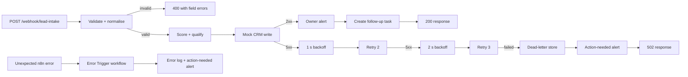

# Resilient lead intake — local n8n demo

This public proof asset shows one complete business workflow:

> Lead intake → validate and normalise → score and qualify → write to CRM → alert owner → follow-up

It runs locally without third-party accounts. n8n orchestrates the workflow; a small Node server stands in for the CRM, alert channel, dead-letter store, and unexpected-error log. All included leads are synthetic.

## What the demo proves

- Invalid requests receive a useful HTTP 400 response before any write.
- Email and phone values are normalised before scoring.
- Scoring rules live together in the `SCORE_CONFIG` object in the **Score and Qualify** node.
- A caller-supplied or deterministic idempotency key prevents duplicate CRM records.
- CRM 5xx responses retry after 1 second and then 2 seconds.
- A third failed attempt creates a dead-letter record, sends an `action_needed` alert, and returns HTTP 502.
- Successful writes send a lead-owner alert and return the CRM result.
- Every successful or duplicate CRM result creates an explicit open follow-up task.
- A separate Error Trigger workflow records and alerts on unexpected n8n execution failures.

The follow-up step is a separate HTTP action after the owner alert. Its task contains the CRM ID and idempotency key and defaults to a 24-hour due interval. The [connector swap guide](docs/REAL-CONNECTORS.md) shows how to replace the mocks with account-backed nodes.

## Architecture



## Five-minute run

Requirements: Node 20 or newer. Docker is optional.

### Option A — local n8n on PowerShell

Open PowerShell in this directory, then use three terminals.

Terminal 1:

```powershell
node app/server.js
```

Terminal 2, first run only:

```powershell
$env:npm_config_cache = "$PWD\.npm-cache"
$env:N8N_USER_FOLDER = "$PWD\.n8n"
$env:N8N_BLOCK_ENV_ACCESS_IN_NODE = "false"
$env:MOCK_BASE_URL = "http://127.0.0.1:3001"
$env:MOCK_API_KEY = "demo-local-key"
npx --yes n8n@1.121.3 import:workflow --input=workflows/error-handler.workflow.json
npx --yes n8n@1.121.3 import:workflow --input=workflows/lead-intake.workflow.json
npx --yes n8n@1.121.3 update:workflow --id=pakvaroLeadIntakeDemo --active=true
npx --yes n8n@1.121.3 start
```

On later runs, set the same environment variables and run only the final `start` command.

Terminal 3:

```powershell
node tests/run-tests.js
```

Expected final line: `Result: 5/5 tests passed`.

If the CLI declines activation, open <http://127.0.0.1:5678>, finish the local owner setup if prompted, open **Pakvaro Demo - Resilient Lead Intake**, and switch **Inactive** to **Active**. Confirm that the workflow shows as active. The production webhook is `http://127.0.0.1:5678/webhook/lead-intake`.

### Option B — Docker Compose

```powershell
docker compose up
```

In another terminal:

```powershell
node tests/run-tests.js
```

The Compose command imports both workflows and activates the lead-intake workflow. To start again with an empty n8n database, run `docker compose down -v`; this deletes only the named demo volume.

## Try one lead

```powershell
$body = @{
  name = "Aarav Demo"
  company = "Northstar Kitchens"
  email = "AARAV@NORTHSTAR.EXAMPLE"
  phone = "98765 43210"
  budget = 125000
  timelineDays = 21
  source = "website"
  message = "Need workflow automation and CRM integration."
} | ConvertTo-Json

Invoke-RestMethod `
  -Method Post `
  -Uri "http://127.0.0.1:5678/webhook/lead-intake" `
  -Headers @{ "x-idempotency-key" = "readme-demo-0001" } `
  -ContentType "application/json" `
  -Body $body
```

Inspect local state:

```powershell
Invoke-RestMethod `
  -Uri "http://127.0.0.1:3001/admin/state" `
  -Headers @{ "x-demo-key" = "demo-local-key" }
```

`demo-local-key` is deliberately a local demo value, not a secret. Use the environment-variable rotation steps in [RUNBOOK.md](RUNBOOK.md) outside this isolated demo.

## Repository map

- `workflows/lead-intake.workflow.json` — main importable workflow.
- `workflows/error-handler.workflow.json` — unexpected-error workflow.
- `app/server.js` — dependency-free local mocks and JSONL event log.
- `tests/run-tests.js` — five end-to-end acceptance tests.
- `tests/fixtures.js` — synthetic test leads.
- `docs/REAL-CONNECTORS.md` — exact mock-to-real connector swaps.
- `RUNBOOK.md` — dead-letter response, replay, and key rotation.
- `LIMITS.md` — explicit proof boundaries.
- `VIDEO-SCRIPT.md` — three-minute uncut walkthrough.
- `evidence/` — captured command output and execution summaries.

## Screenshots to capture

1. Full n8n canvas, with the three CRM attempts and dead-letter branch visible.
2. **Score and Qualify** node showing the single scoring config object.
3. Test terminal ending in `Result: 5/5 tests passed`.
4. Mock state after the happy path: one normalised CRM lead, one `lead_owner` alert, and one open follow-up.
5. Mock state after forced outage: one dead letter and one `action_needed` alert.
6. n8n Executions list showing successful, recovered, and dead-lettered runs.

Do not capture credentials, environment-variable values used outside this demo, or real lead data.
